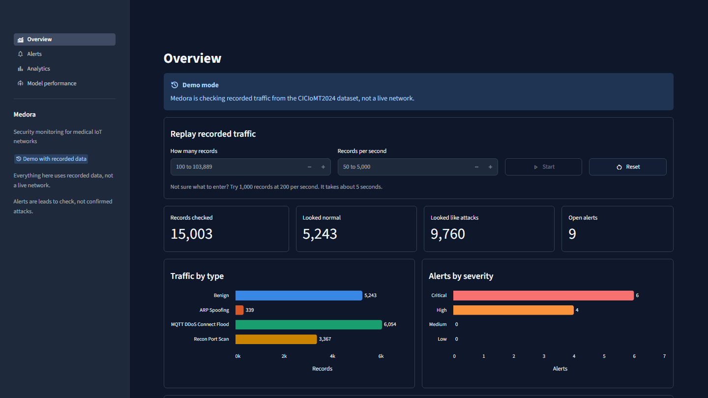
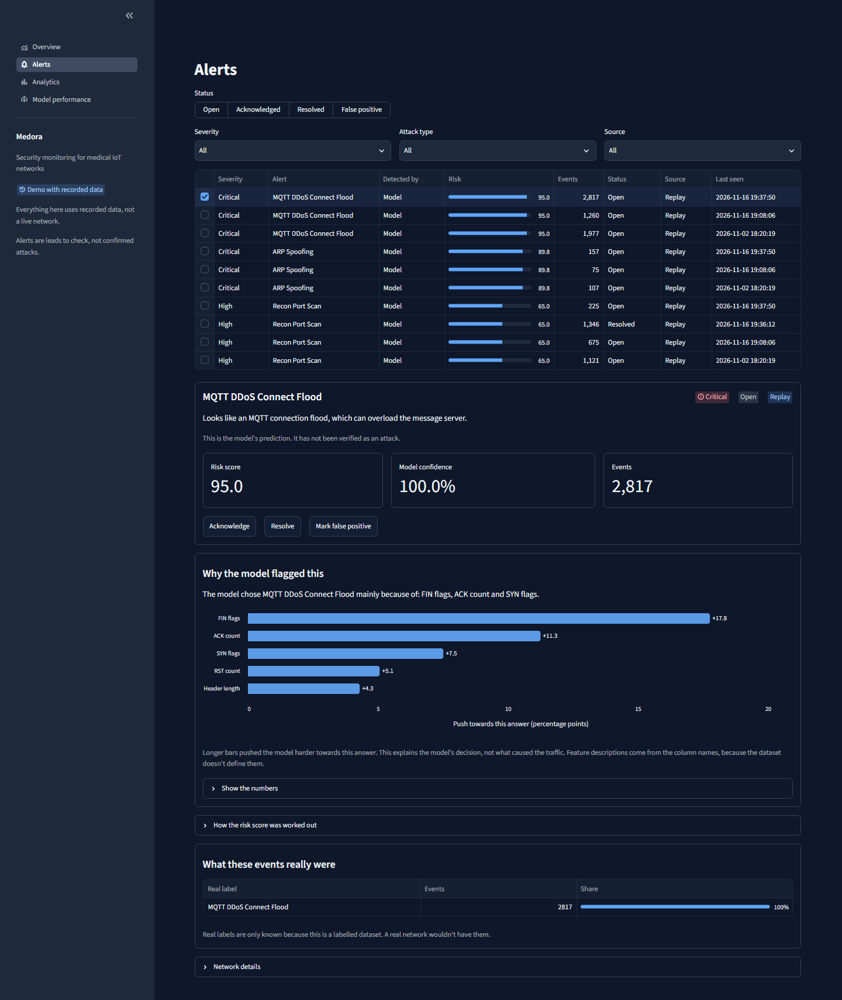
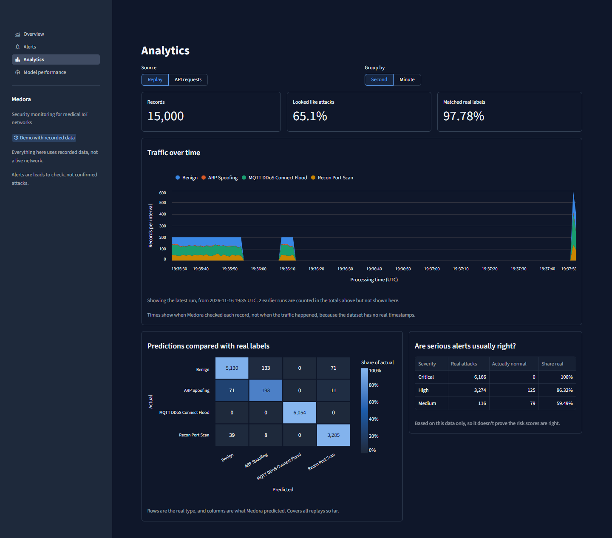
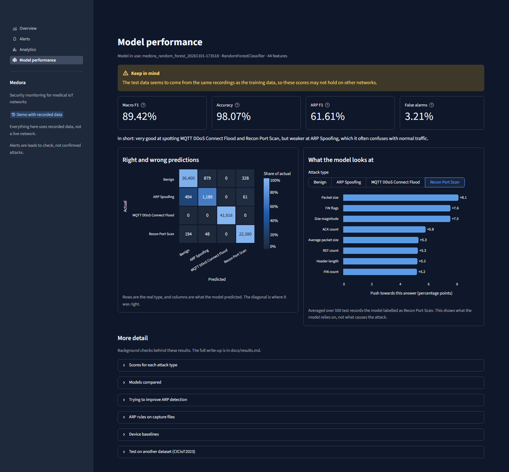
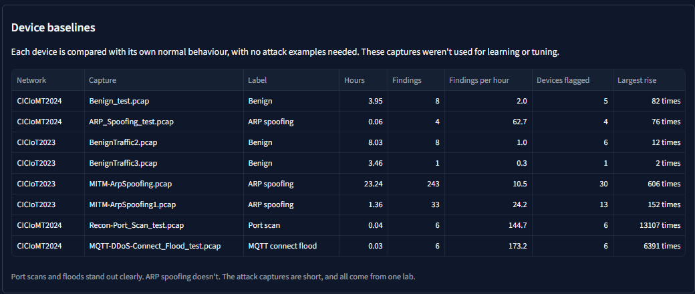

# Medora

IoMT network security monitoring with machine learning, explainable AI (XAI), and per-device behaviour baselines.

Medora analyses network traffic from medical IoT devices, detects likely attacks, scores their risk, and explains each alert in plain language. It was built and evaluated on the CICIoMT2024 dataset, using recorded traffic only.



## Features

- Detects ARP spoofing, MQTT connection floods, and port scans with a Random Forest model
- Scores every alert from 0 to 100 and groups repeated detections
- Explains each alert using explainable AI (XAI), showing which features led to the prediction
- Learns each device's normal behaviour and flags large changes, without attack examples
- Checks capture files for ARP spoofing using rules
- Provides a REST API, SQLite storage, and a Streamlit dashboard

## How It Works

```
Dashboard <──> API ──> Input validation ──> Random Forest
                │                                │
   Replay ──────┘     Database <── Alerts <── Risk score
```

1. Recorded traffic records are replayed into the API.
2. Invalid records are rejected with a reason.
3. The model classifies each record as normal traffic or one of three attacks.
4. Each detection receives a risk score, and repeated detections are grouped into alerts.
5. The dashboard shows alerts, explanations, and model results.

## Explainability (XAI)

Medora explains its predictions at two levels:

- **Per alert:** a one-sentence reason and a chart of the features that pushed the model towards its answer.
- **Overall:** the features the model relies on most for each attack type, averaged over test records.

Both use tree path contributions from the Random Forest, which trace how each decision in the model changes the predicted probability. Features are shown with plain names, such as "FIN flags" instead of `fin_flag_number`. The explanations describe how the model reached its answer, not what caused the traffic.

## Results

Evaluated on 103,889 held-out test records:

| Metric | Score |
|---|---:|
| Macro F1 | 89.42% |
| Accuracy | 98.07% |
| ARP spoofing F1 | 61.61% |
| False alarm rate | 3.21% |

- Floods and port scans are detected reliably. ARP spoofing is the weakest class.
- The `IAT` feature was excluded because it appeared to identify the recording rather than the attack. Including it raised macro F1 to 94.26%, but that score would be misleading.

Device baselines, learned from normal traffic only, compared by the largest rise above any device's normal limit:

| Traffic | Largest rise |
|---|---:|
| Port scan | 13,107× |
| MQTT connection flood | 6,391× |
| ARP spoofing | 76× |
| Normal traffic | 82× |

Floods and port scans stand out clearly. ARP spoofing does not. See [docs/results.md](docs/results.md) for the full evaluation.

## Screenshots

**Alerts:** each alert explains which features led to the prediction.



**Analytics:** predictions compared with the dataset's labels.



**Model performance:** key scores and the features the model relies on for each attack type.



**Device baselines:** results on held-out capture files.



## Tech Stack

Python, scikit-learn, pandas, NumPy, FastAPI, SQLite, Streamlit, Altair, dpkt, pytest

## Getting Started

Requires Python 3.11. Commands are for Windows PowerShell.

```powershell
git clone https://github.com/dd0906/Medora.git
cd Medora
py -3.11 -m venv .venv
.venv\Scripts\Activate.ps1
pip install -r requirements.txt
```

Download the dataset as described in [data/README.md](data/README.md), then build the data and train the model (about 15 minutes):

```powershell
python experiments\prepare_dataset.py
python -m scripts.run_protocol
```

Start the API with the trained model:

```powershell
$env:MEDORA_MODEL_PATH = "models\medora_random_forest_<run time>.joblib"
python -m uvicorn backend.main:app --host 127.0.0.1 --port 8000
```

Start the dashboard in a second terminal:

```powershell
python -m streamlit run dashboard/app.py
```

Open http://127.0.0.1:8501, enter 1,000 records at 200 per second, and press **Start**. API documentation is available at http://127.0.0.1:8000/docs.

## Additional Tools

| Task | Command |
|---|---|
| Check a capture file for ARP spoofing | `python -m scripts.analyze_pcap capture.pcap --send` |
| Learn device baselines from normal traffic | `python -m scripts.device_baselines learn normal.pcap --output models\device_baseline.json` |
| Check a capture against a baseline | `python -m scripts.device_baselines check capture.pcap --baseline models\device_baseline.json --send` |
| Rebuild the model explanation summary | `python -m scripts.explain_model` |
| Run the tests | `python -m pytest` |

## Limitations

- Tested on recorded data only, not live traffic.
- ARP spoofing detection is weak: 44% of ARP predictions were incorrect.
- Test data appears to come from the same recordings as the training data, so results may not generalise to other networks.
- Both datasets appear to come from the same lab.
- Device baselines have not been tested on normal traffic from a different day.
- Risk scores are hand-set and have not been validated by clinical security staff.
- Not designed for public deployment: the API has only an optional key.

Alerts are leads for investigation, not confirmed incidents.

## Documentation

- [Architecture](docs/architecture.md)
- [Methodology](docs/methodology.md)
- [Results](docs/results.md)
- [Dataset setup](data/README.md)

## License

[MIT License](LICENSE). The datasets are not included and have their own terms.
