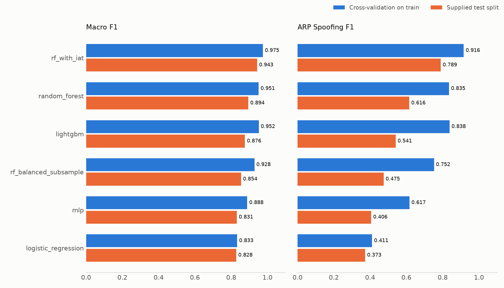

# Results and audit findings

Source: `experiments/evaluation/20261101-173518/`. All numbers below were produced by running the code in this repository. The active model is Random Forest using 44 features, without `IAT`.

## Model comparison

Cross-validation on training data decided the selection. The test columns played no part in it.

| Model | CV macro F1 | Test accuracy | Test balanced accuracy | Test macro F1 | Test ARP F1 | Test benign false alarm rate |
|---|---|---|---|---|---|---|
| **Random Forest (selected)** | 0.9511 | 0.9807 | 0.9097 | 0.8942 | 0.6161 | 3.21% |
| LightGBM | 0.9522 | 0.9774 | 0.9176 | 0.8759 | 0.5408 | 4.46% |
| RF, `balanced_subsample` | 0.9280 | 0.9663 | 0.9332 | 0.8542 | 0.4746 | 7.61% |
| MLP | 0.8883 | 0.9609 | 0.8730 | 0.8311 | 0.4060 | 7.64% |
| Logistic Regression | 0.8328 | 0.9690 | 0.8428 | 0.8282 | 0.3727 | 3.67% |
| RF with `IAT` (diagnostic, not selectable) | 0.9749 | 0.9903 | 0.9551 | 0.9426 | 0.7894 | 1.59% |

LightGBM's cross-validation lead over Random Forest was 0.0011, inside the 0.005 tolerance fixed in advance, so the rule kept Random Forest.

### Selected model on the test split

| Class | Precision | Recall | F1 | Records |
|---|---|---|---|---|
| Benign | 0.9814 | 0.9679 | 0.9746 | 37,607 |
| ARP Spoofing | 0.5619 | 0.6818 | 0.6161 | 1,744 |
| MQTT DDoS Connect Flood | 1.0000 | 1.0000 | 1.0000 | 41,916 |
| Recon Port Scan | 0.9829 | 0.9893 | 0.9861 | 22,622 |

Macro ROC-AUC is 0.9959 and macro PR-AUC is 0.9352. Attack detection rate is 98.96% and alert precision is 98.19%. Scoring takes about 1.9 µs per row in a multi-threaded batch and about 7.5 ms for a single record on one thread.

| Actual \ Predicted | Benign | ARP | MQTT | Recon |
|---|---|---|---|---|
| Benign | 36,400 | 879 | 0 | 328 |
| ARP | 494 | 1,189 | 0 | 61 |
| MQTT | 0 | 0 | 41,916 | 0 |
| Recon | 194 | 48 | 0 | 22,380 |

ARP Spoofing is the weak point: 44% of ARP predictions were wrong, and 28% of real ARP records were labelled benign. The flood and scan classes remain strong, but their scores may still benefit from capture-specific patterns, because the test split comes from the same captures.

## Why `IAT` was removed

`IAT` should be an inter-arrival time, but it behaves differently:

- About half of the benign, ARP, and Recon rows hold very small values. The rest, along with nearly all MQTT rows, hold values of about 8.5×10⁷ to 1.7×10⁸.
- Those large values depend on the class. Median training values among those rows are about 169.47M for benign, 169.40M for ARP, 169.41M for Recon, and 84.67M for MQTT.
- Within a class, values rise with file order, and test values continue from where training values stop. The train-to-test KS distance is 0.998 for MQTT and 0.500 for the other classes, higher than for any other feature.
- A one-feature decision tree using only `IAT` reaches 88.55% accuracy and 0.78 macro F1 on the test split.

The most likely explanation is that these large values are a clock-like reading from each attack's capture session. That is an inference from the data and hasn't been confirmed against the dataset's feature-extraction code. A model using it can partly recognize which capture a record came from, and that wouldn't carry over to a real network.

Removing it lowers the test macro F1 from 0.9426 to 0.8942 and doubles benign false alarms. That is the cost of a model that no longer uses this feature, so the lower number is the one this project reports. The decision was made on those grounds, and it reduces the reported scores rather than inflating them.

## Where the earlier numbers came from

All of these used `IAT`, so none describes the active model.

| Recorded figure | What it actually was | Status |
|---|---|---|
| 97.94% accuracy, 89.53% macro F1 | Random Forest with `balanced_subsample`, on the supplied test split | Reproduced exactly. That model was later overwritten |
| 99.28% accuracy | Unweighted Random Forest with `Drate` dropped, on a random 80/20 split of the **training** file | Validation result, not a test score |
| 99.03% accuracy | `medora_rf.joblib`, unweighted, on the supplied test split | Reproduced exactly. Kept on disk but no longer active |
| 96.025% Logistic Regression | Random 80/20 validation split of the training file | Validation result, not a test score |

The earlier MLP (97.02%) and LightGBM (99.27%) figures in `experiments/results/` were also validation-only.

## Other findings

### Validation scores overstate performance

| Random Forest without `IAT` | Cross-validation | Supplied test |
|---|---|---|
| Macro F1 | 0.9511 | 0.8942 |
| ARP precision | 0.9325 | 0.5619 |
| Benign false alarm rate | 0.31% | 3.21% |

The gap isn't caused by duplicates. Only 357 test rows, all Recon, have exact copies in the training data, and removing them changes accuracy by less than 0.0001. Train-only validation should be treated as optimistic.

### Attempt to improve ARP detection

`scripts/improve_arp.py` compared 13 Random Forest variants, each at 6 ARP decision thresholds, using training data only: each variant was fitted on earlier records of each class and validated on later ones. The results are in `experiments/evaluation/arp_search_20261102-193515/`.

Forward validation is far closer to the test split than random folds:

| Current model | Random cross-validation | Forward validation | Supplied test |
|---|---|---|---|
| ARP F1 | 0.8351 | 0.6153 | 0.6161 |
| Macro F1 | 0.9511 | 0.8846 | 0.8942 |

Forward scores vary widely by fold (ARP F1 from 0.34 to 0.79), so this close match on the means may be partly chance.

The rule chose `max_features=0.3`, the highest scorer. It gained 0.028 in forward ARP F1 against a required 0.01, and it was also better across 3 other seeds, mostly in the fold with the least training data. A bar was set before scoring it: activate it only if test ARP F1 didn't fall.

| Supplied test | Current model | `max_features=0.3` |
|---|---|---|
| ARP F1 | 0.6161 | 0.5941 |
| ARP precision | 0.5619 | 0.5165 |
| ARP recall | 0.6818 | 0.6990 |
| Macro F1 | 0.8942 | 0.8856 |
| Benign false alarm rate | 3.21% | 4.57% |

It failed, so it wasn't activated. The model is kept as `medora_random_forest_20261102-194943.joblib` for the record, and the search stopped there, because trying more variants against the test split would amount to fitting to it. This single comparison used one seed, and test-split seed variation wasn't measured.

The other results were:

- **Regularization, more trees, and ratio features:** these made little difference.
- **ARP class weight:** this reduced ARP F1 slightly.
- **Scaling ARP's probability before choosing a class:** this traded precision against recall. A multiplier of 0.7 on the current model gained 0.014 in forward ARP F1, with precision up and recall down. It wasn't scored on the test split, and the Detector doesn't support it.
- **Keeping only time-stable features:** this was clearly worse, so those features can't simply be removed.

None of this produced a confirmed improvement in ARP detection. Larger gains probably need better information about the traffic, such as features extracted from the original captures, but that hasn't been tested.

### The test split doesn't measure generalization

Test records appear to be a later part of the same captures as the training records. Even the scores above don't show how Medora would do on other networks or devices.

### Class weighting trades too much precision

On the test split, `balanced_subsample` raises ARP recall from 68.2% to 82.3% but drops ARP precision from 56.2% to 33.3%, and more than doubles benign false alarms. Cross-validation also prefers the unweighted model.

### Outside-data check: CICIoT2023

`scripts/external_check.py` compared Medora with benign, ARP spoofing, and port scan records from CICIoT2023, a dataset from the same lab (`experiments/evaluation/external_ciciot2023_20261102-202355/`). Labels come from the folder names, and 84 of 1,488,035 rows with invalid values were refused.

**The active model can't be scored there.** Seven of its features are absent (`Duration`, `Srate`, `Drate`, `Magnitue`, `Radius`, `Covariance`, `Weight`), and many shared column names hold differently computed values:

| Benign median | CICIoMT2024 | CICIoT2023 |
|---|---|---|
| `Header_Length` | 170,534 | 29.6 |
| `rst_count` | 1,798 | 0 |
| `ack_count` | 0 | 9 |
| `Variance` | 0.9 | 163,434 |
| `Number` | 5.5 | 10 |
| `IAT` | 169,461,489 | 0.007 |

To get the fairest available result, throwaway Random Forests were fitted on CICIoMT2024 training data using only the shared columns, and scored on both datasets:

| Fitted on | Scored on | Accuracy | Macro F1* | ARP recall | Port scan recall | Attack detection | Benign false alarms |
|---|---|---|---|---|---|---|---|
| 37 shared features | CICIoMT2024 test | 97.46% | 0.8786 | 67.1% | 98.7% | 98.95% | 4.72% |
| 37 shared features | CICIoT2023 | 73.28% | 0.3494 | 0.5% | 10.5% | 8.93% | 1.63% |
| 19 most comparable features | CICIoMT2024 test | 97.34% | 0.7357 | 0.0% | 95.9% | 95.96% | 0.20% |
| 19 most comparable features | CICIoT2023 | 71.21% | 0.3457 | 2.7% | 8.7% | 8.58% | 4.92% |

*Over the classes present in that dataset. "Most comparable" means a benign KS distance of 0.2 or less between the datasets, so this choice did use CICIoT2023's benign data. Always predicting benign would score 73.80% accuracy on these CICIoT2023 records, so neither model beats that baseline.

What this does and doesn't show:

- **Shows:** models trained on these CICIoMT2024 CSVs don't transfer to CICIoT2023's CSVs, and the published CSV columns can't be treated as interchangeable.
- **Doesn't show:** how Medora would do on outside traffic with properly matched features. The result mixes different devices and networks with different feature calculations, and can't separate them. A fair test would need both datasets' PCAPs processed by the same extractor.
- **ARP needs the incomparable features:** with only the 19 comparable features, ARP recall is 0% even on CICIoMT2024.

Two related observations are suggestive, not confirmed. `IAT` is tiny in CICIoT2023, which fits the view that CICIoMT2024's large values aren't real inter-arrival times. CICIoMT2024's `Duration` also looks like a time-to-live value (median 64, maximum 255), and CICIoT2023 has `Time_To_Live` where `Duration` would be.

### About device labels

The capture-based results below name devices as Device A, Device B, and so on, using the same label across both datasets. Their MAC addresses aren't published, because it isn't clear whether the datasets' terms cover sharing them. For the same reason, the raw result files for these sections stay out of this repository. Running the scripts with the datasets recreates them, with the real addresses, under `experiments/evaluation/`.

### ARP rules on real captures

`scripts/evaluate_arp_rules.py` runs rule-based ARP spoofing detection on raw captures. Labels apply to whole captures, so this measures whether a capture was flagged, not per-packet accuracy, and it can't be compared directly with the model's ARP F1.

The thresholds were written before any real capture was read and haven't been changed. After reading the CICIoMT2024 training captures, a capture counts as flagged only if `binding_flapping` or `unsolicited_reply_burst` fires, because those were the only rules silent on benign training traffic. `ip_mac_conflict` and `mac_claims_many_addresses` became supporting evidence. The test captures were then scored once.

| Group | Capture | Label | Flagged | Primary findings | First primary finding |
|---|---|---|---|---:|---:|
| CICIoMT2024 train | `ARP_Spoofing_train.pcap` | ARP spoofing | Yes | 12 | 119.8 s |
| CICIoMT2024 train | `Benign_train.pcap` (22.1 h) | Benign | No | 0 | None |
| **CICIoMT2024 test** | `ARP_Spoofing_test.pcap` (3.8 min) | ARP spoofing | Yes | 1 | 114.3 s |
| **CICIoMT2024 test** | `Benign_test.pcap` (3.9 h) | Benign | **Yes (false alarm)** | 3 | 10,451.6 s |
| CICIoT2023 | `MITM-ArpSpoofing.pcap` | ARP spoofing | Yes | 75 | 17.8 s |
| CICIoT2023 | `MITM-ArpSpoofing1.pcap` | ARP spoofing | Yes | 14 | 17.6 s |
| CICIoT2023 | `BenignTraffic1.pcap` (7.2 h) | Benign | No | 0 | None |
| CICIoT2023 | `BenignTraffic3.pcap` (3.5 h) | Benign | No | 0 | None |

**The fixed rule set failed the held-out benign test.** All three false findings were `unsolicited_reply_burst` on Device B, which also answers for `192.168.137.1` in the other CICIoMT2024 captures. That's about 0.76 false findings per hour on that capture, though they fall in one short cluster.

Across those eight captures, `binding_flapping` alone fired on all four attack captures and none of the four benign ones. That pattern was noticed after the test was scored, so it was then tested on two unread benign captures, with a bar fixed in advance: zero firings.

**The flapping-only rule failed that test and wasn't adopted:**

| Capture | Label | `binding_flapping` findings | Other findings |
|---|---|---:|---:|
| `BenignTraffic.pcap` (9.3 h) | Benign | 7 | 2 `ip_mac_conflict` |
| `BenignTraffic2.pcap` (8.0 h) | Benign | 0 | 0 |

All nine findings concern `192.168.137.249`, repeatedly claimed by Device C and Device D for hours. This looks like two devices with the same IP, though that is an inference. It shows the limit of this approach: from ARP traffic alone, a duplicate IP can look just like spoofing.

Overall, with the rules as fixed before testing, all 4 attack captures were flagged, and so were 2 of the 6 benign captures. The findings should be treated as leads for an analyst, not as reliable automatic detections.

Every attack capture here targeted `192.168.137.1`, which appears to be the gateway. Watching only critical addresses like the gateway might avoid the false alarm above, but no unused benign captures remain from these sets to test that fairly, so it's untested.

Other limits:

- **Small test set:** the ARP test capture is under 4 minutes and has 185 ARP frames, and there are only two test captures.
- **Not an independent network:** CICIoT2023 uses the same `192.168.137.x` subnet and the same MAC address for Device A as the CICIoMT2024 ARP captures, so it appears to be the same lab, and possibly the same attack tool. It doesn't show that the rules work on other networks or against other spoofing tools.
- **Unconfirmed attribution:** that Device A is the attacker is inferred from the traffic. The same address also sends 1,045 ARP frames in `BenignTraffic.pcap` without any conflict, so it's probably a lab device that normally behaves. The Device C address that conflicts on `.197` in the attack captures also conflicts on `.249` in benign traffic, so those attack-capture findings may be innocent too.
- **Evasion:** these rules are public and simple. An attacker who claims an address once and stays quiet wouldn't trigger the flapping rule.

The benign captures also have ARP shares similar to or higher than the attack captures (for example, 2.48% for `BenignTraffic3.pcap` against 1.18% for `MITM-ArpSpoofing1.pcap`). So the amount of ARP traffic alone doesn't separate them here, while who claims each address often does. This may be part of why models on summary features struggle with ARP, but that hasn't been tested.

The dataset's README says its features were built with TCPDUMP and DPKT, but it doesn't define `IAT`, so that question stays open.

### Per-device baselines on real captures

`scripts/evaluate_baselines.py` tests whether each device can be judged against its own benign history, with no attack examples. The steps are in the [methodology](methodology.md#device-baseline-evaluation).

Tuning chose a 99th percentile limit with a multiplier of 3, on any 1 measure for 1 minute, for CICIoMT2024. For CICIoT2023 it chose a multiplier of 1, on any 1 measure for 3 minutes in a row.

| Network | Capture | Label | Length | Findings | Per hour | Devices flagged | Usual holder challenged? | Rank of challenger |
|---|---|---|---:|---:|---:|---:|---|---:|
| CICIoMT2024 (development) | `ARP_Spoofing_train.pcap` | ARP spoofing | 1.72 h | 27 | 15.70 | 12 of 22 | `192.168.137.1` | 1st |
| **CICIoMT2024** | `Benign_test.pcap` | Benign | 3.95 h | 8 | 2.03 | 5 of 23 | `192.168.137.250` | 5th |
| **CICIoMT2024** | `ARP_Spoofing_test.pcap` | ARP spoofing | 3.8 min | 4 | 62.71 | 4 of 20 | `192.168.137.1` | Joint 1st |
| **CICIoT2023** | `BenignTraffic2.pcap` | Benign | 8.03 h | 8 | 1.00 | 6 of 73 | No | None |
| **CICIoT2023** | `BenignTraffic3.pcap` | Benign | 3.46 h | 1 | 0.29 | 1 of 71 | No | None |
| **CICIoT2023** | `MITM-ArpSpoofing.pcap` | ARP spoofing | 23.24 h | 243 | 10.46 | 30 of 80 | `192.168.137.1` | 7th |
| **CICIoT2023** | `MITM-ArpSpoofing1.pcap` | ARP spoofing | 1.36 h | 33 | 24.21 | 13 of 72 | `192.168.137.1` | 9th |

Bold rows were held out. The rank orders flagged devices by minutes flagged. `MITM-ArpSpoofing.pcap` contains a 14.8-hour gap, which lowers its hourly rate.

| Network | Benign per hour | Attack per hour | Attack compared with benign | Benign mark (2 or fewer) | Separation mark (5 times) |
|---|---:|---:|---:|---|---|
| CICIoMT2024 | 2.03 | 62.71 | 30.9 times | **Missed** | Met |
| CICIoT2023 | 0.78 | 11.22 | 14.3 times | Met | Met |

**CICIoMT2024 narrowly missed its benign mark, and the mark wasn't moved.** Baseline alerts therefore stay at Low risk. Benign rates also rose from tuning to held-out traffic on both networks: from 0.60 to 2.03 per hour on CICIoMT2024, and from 0.40 to 0.78 on CICIoT2023.

**The strongest supporting evidence doesn't come from the baselines.** In all 4 attack captures, across both datasets, Device A claims `192.168.137.1` while its usual holder is also claiming it. It never claims that address in any of the 6 benign captures. Baselines ranked that device first or joint first on CICIoMT2024, and flagged it without using this evidence. It's still an inference that this device is the attacker, because neither dataset names one.

Limits on this result:

- **Session effects can't be ruled out:** this is the main limit. In both datasets, the held-out benign capture directly continues the training capture. The attacks were recorded a week earlier on CICIoMT2024 and about nine days later on CICIoT2023. So benign rates here are probably optimistic, and some of the attack gap may come from recording on a different day. Measuring that needs benign traffic from a separate day, which these captures don't include.
- **Findings don't pinpoint the attacker:** many devices are flagged during attacks, including 30 of 80 in one capture. The likely attacker ranked only 7th and 9th on CICIoT2023, so the first-place ranking on CICIoMT2024 didn't carry over. A spoofing attack affects its victims too, but this also fits the session effect above.
- **Very small attack test:** the CICIoMT2024 rate comes from 4 findings in under 4 minutes, so 62.71 per hour is a rough figure. The development capture's 15.70 per hour is steadier, and is 7.7 times the held-out benign rate.
- **The address check wasn't independently tested:** it was written after seeing that attacks target `192.168.137.1`, and every capture here has already been read. It also fired once on benign traffic, when Device E, a device new to the baseline, claimed an address alongside its usual holder. It's reported as evidence and isn't used to raise alerts.
- **Not an independent network:** both datasets appear to come from the same lab. The method was repeated on each one with its own baseline, but neither baseline was tested on the other.
- **Poisoning:** anything in the learning traffic becomes normal. An attacker active during learning, or one who stays below a device's limits, wouldn't be flagged.

#### Other attack types

The saved CICIoMT2024 baseline then scored two attack types it hadn't been evaluated on, unchanged and once. The mark, set before reading them, was 5 times the held-out benign rate of 2.03 per hour. Both passed, and both raised the measures predicted beforehand.

| Capture | Length | Findings | Per hour | Times the benign rate | Devices flagged |
|---|---:|---:|---:|---:|---:|
| `Recon-Port_Scan_test.pcap` | 2.5 min | 6 | 144.73 | 71.4 | 6 of 21 |
| `MQTT-DDoS-Connect_Flood_test.pcap` | 2.1 min | 6 | 173.16 | 85.4 | 6 of 20 |

These rates come from about 2 minutes each, so the size of the rise says more. This table shows the furthest any device went above its own limit, which was measured after the fact:

| Capture | Label | Device | Measure | Observed per minute | Device's limit | Times over |
|---|---|---|---|---:|---:|---:|
| `Recon-Port_Scan_test.pcap` | Port scan | Device A | Destination ports | 65,535 | 5 | 13,107 |
| `MQTT-DDoS-Connect_Flood_test.pcap` | MQTT flood | Device G | New TCP connections | 63,914 | 10 | 6,391 |
| `MITM-ArpSpoofing.pcap` | ARP spoofing | Device H | Bytes sent | 40,836,557 | 67,410 | 606 |
| `Benign_test.pcap` | Benign | Device F | Frames received | 31,874 | 387 | 82 |
| `ARP_Spoofing_test.pcap` | ARP spoofing | Device I | Bytes sent | 4,571,217 | 60,000 | 76 |
| `BenignTraffic2.pcap` | Benign | Device J | Frames received | 857 | 72 | 12 |

- **Port scan:** Device A reached all 65,535 ports with about 106,000 new connections in a minute, where its typical count is 0. Device F received 104,900 frames in a minute and sent back 102,847, which looks like the scan's target answering.
- **MQTT flood:** Device A, Device G, and two similar devices each rose over 2,300 times above their new-connection limit. Each normally sends 1 or 2 frames per active minute. Two more devices were flagged only as unknown to the baseline, so that may say nothing about the attack.
- **Attacker identity is still inferred:** the dataset doesn't name attacking devices, but these patterns are hard to explain any other way.

**What this does and doesn't show:**

- **Loud attacks separate clearly:** these rises are at least 28 times the largest in the held-out benign captures, with no attack examples used. Normal day-to-day change seems unlikely to explain all of that, though these captures were also recorded on different days from the benign traffic, and that hasn't been measured.
- **Quiet attacks don't:** ARP spoofing's largest rises overlap with benign traffic's, and in `ARP_Spoofing_test.pcap` the likely attacker went only 1.2 times over its limit. Baselines add little for ARP spoofing on their own, and the address check above is the stronger signal.
- **Not a better detector for these classes:** the Random Forest already handles port scans and floods well on the test split, and a simple rate limit would probably catch these too. What baselines add is needing no attack labels, and naming a device with its own history. Whether they catch attacks unlike these hasn't been tested.
- **Unused rule:** a rule such as "over 1,000 times the limit raises severity" would fit these results, but it was noticed after scoring and no unread captures remain to test it, so alerts stay at Low.

### Data quality

- `Rate` and `Srate` are exact duplicates, as are `IPv` and `LLC`, and `Drate` is constant. The model keeps all of them.
- There are no missing or infinite values in any split, and no feature vector appears with conflicting labels. One benign training row has a negative `IAT`.
- Earlier scripts' splits could put duplicate rows on both sides of validation: 1,103 of 93,160 validation rows in a random split matched a training row. The new protocol prevents this.

## Full-chain verification

The entire test split was replayed over HTTP through validation, the model, risk scoring, alert grouping, and SQLite (`experiments/evaluation/replays/replay_20261101-175203.json`):

- 101,885 of 103,889 records were correct, matching the offline accuracy exactly, and per-class prediction counts match the confusion matrix. No records were rejected.
- Throughput was about 3,200 records per second on the development laptop.
- All detections grouped into 3 alerts, one per attack class, because the dataset has no addresses to separate them.

Share of alerted events that were real attacks, by the severity at the time of each event:

| Severity | Real attacks | Actually benign | Share real |
|---|---|---|---|
| Critical | 42,743 | 2 | 99.995% |
| High | 22,257 | 875 | 96.22% |
| Medium | 594 | 330 | 64.29% |

Higher severity did track higher precision here. These figures depend on class mix, replay order, and speed, so they describe this replay and aren't a validation of the risk weights.

## Audit corrections to the project record

- `experiments/compare_models_on_test.py` treated `medora_rf.joblib` as class-weighted after that file became unweighted. Rerunning it would have overwritten the only record of the 97.94% run with mislabelled numbers, so it now refuses to run in that state.
- `requirements.txt` was UTF-16 and omitted LightGBM and other direct dependencies. It's now UTF-8 and complete for the platform.
- An undocumented 1D CNN exists in `experiments/train_cnn.py`, scoring 0.8320 validation macro F1 with `IAT` included. It treats arbitrarily ordered columns as a sequence, wasn't competitive, and isn't part of the platform.
- The first protocol run, which included `IAT`, is kept in `experiments/evaluation/20261101-170248/` with its model and replay.
